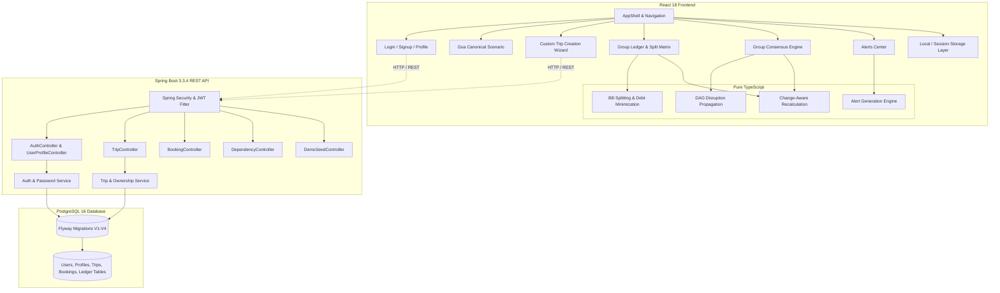

# TripSync — Intelligent Group Travel Planning & Expense Management

> **Academic Project Submission & Demonstration Freeze**  
> **Repository:** [HEMAN-57/TripSync](https://github.com/HEMAN-57/TripSync)  
> **Evaluation Status:** Stable Academic Prototype (Ready for Evaluation & Demonstration)  
> **Test Suite:** **220 Passing Tests** (157 Frontend Vitest + 63 Backend JUnit 5 / Testcontainers)  
> **Type Safety:** 100% Strict TypeScript (`strict: true`, zero `any`) & Java 21 Spring Boot  

---

## 1. Project Overview & Problem Statement

### The Problem
Group travel planning is notoriously fraught with coordination breakdowns, financial opacity, and interpersonal friction:
1. **Asymmetric Budgets and Conflicting Priorities:** Within the same group, one traveller may have a strict ₹12,500 limit and wish to minimize out-of-pocket costs, while another has a ₹22,000 budget and prioritizes preserving activities or arriving early. Standard travel tools treat groups as homogenous units.
2. **Unequal Participation and Unfair Bill Splitting:** Fixed costs (resort bookings, shared cabs) belong to everyone, but optional excursions (scuba diving, safari passes) only apply to participating members. Flat 50/50 splits create resentment and budget overruns.
3. **Cascading Disruptions and Replan Paralysis:** When a flight is delayed, an activity cancelled, or a member drops out, traditional tools force groups into chaotic manual recalculations of who owes what and how remaining members absorb shared costs.

### The Solution: TripSync
**TripSync** is an intelligent group travel planning, expense distribution, and change-aware replanning platform. It combines:
- **Directed Acyclic Graph (DAG) schedule modeling** to deterministically track travel dependencies and buffer deficits.
- **Smart Debt-Minimizing Expense Ledgers** that handle equal, unequal, and selective participation splits.
- **A Change-Aware Group Consensus Engine** that recalculates individual financial liabilities and identifies Pareto-optimal group recovery alternatives whenever plans change.

---

## 2. Seven Core Capabilities

| # | Capability | Description |
|---|---|---|
| **1** | **Personalised Trip Planning** | Multi-day itinerary management with flight, rail, hotel, and activity bookings, provider notes, cancellation policies, and deadline tracking. |
| **2** | **Group Preference Balancing** | Distinct member profiles capturing individual budgets, cost sensitivities (`budget`, `balanced`, `splurge`), preferred travel pace, and primary optimization priorities (`minimize-cost`, `preserve-activity`, `earliest-arrival`). |
| **3** | **Smart Budget Management** | Real-time group and member-level budget tracking, variance calculations, and proactive warning indicators when individual or group limits are breached. |
| **4** | **Automated Bill Splitting** | Multi-type expense distribution (equal, custom unequal, selective participants), integrated with an optimal **Debt Simplification Algorithm** that minimizes inter-member transactions. |
| **5** | **Change-Aware Replanning** | Instant recalculation of each member's exact financial liability when bookings are cancelled, prices change, or members leave the trip. |
| **6** | **Smart Alternatives & Consensus** | Objective comparison of candidate recovery options scored against the entire group's collective satisfaction, clearly isolating feasible plans from fallback options. |
| **7** | **Expense Tracking & Alerts Center** | Unified notification center tracking budget violations, tight transfer layovers, approaching cancellation refund cutoffs, and pending settlements. |

---

## 3. Key Differentiator: Change-Aware Group Consensus Engine

Unlike static booking apps or standalone expense splitters (e.g., Splitwise, Excel), TripSync's core innovation is the integration of **schedule dependency analysis** with **group financial rebalancing**:

```
[ Flight Delay / Disruption ]
              │
              ▼
[ DAG Consequence Propagation ] ──> Detects Buffer Deficit & Missed Bookings
              │
              ▼
[ Candidate Recovery Plans ]
              │
              ▼
[ Group Consensus Matrix ] ───────> Evaluates Multi-Member Trade-offs:
                                    • Individual out-of-pocket costs
                                    • Member preference alignments
                                    • Feasibility vs Hard Budget Caps
              │
              ▼
[ Financial Recalculation Engine ] -> Re-allocates shared fixed costs & updates ledger
```

### Recalculation Invariant
When group composition or booking costs change:
$$\text{Per-Person Shared Cost} = \frac{\text{Fixed Shared Expenses}}{\text{Count of Active Participants}}$$
When a member departs, fixed expenses (e.g. ₹36,000 Taj Resort) automatically re-allocate among remaining active members ($4 \to 3$ members: ₹9,000 $\to$ ₹12,000 per person), and individual budget statuses update immediately.

---

## 4. Technology Stack & Architecture

### Technology Stack

| Layer | Technologies | Key Libraries / Characteristics |
|---|---|---|
| **Frontend UI** | React 18, TypeScript, Tailwind CSS, Lucide React | Strict TypeScript, component primitives, responsive design, dark/light theme |
| **Frontend Tooling** | Vite 6, Vitest, React Testing Library | Fast HMR, 151 unit/integration tests, zero `any` types |
| **Backend REST API** | Java 21, Spring Boot 3.3.4 | RESTful controllers, Problem Details (RFC 7807), Bean Validation |
| **Security** | Spring Security 6, JJWT | Stateless JWT authentication, BCrypt hashing, role-based ownership checks |
| **Database & Migration** | PostgreSQL 16, Flyway | Versioned migrations (V1-V4), connection pooling (HikariCP) |
| **Backend Testing** | JUnit 5, AssertJ, Testcontainers | Real PostgreSQL 16 containerized testing across 63 integration tests |

### Architecture Diagram



---

## 5. Local Setup & Execution Guide

### Prerequisites
- **Node.js:** v18.0.0 or higher (`node -v`)
- **Java:** JDK 21 or higher (`java -version`)
- **Docker:** (Optional, for running PostgreSQL via Docker or running backend integration tests via Testcontainers)

### 1. Frontend Setup & Run
From the repository root:
```bash
# 1. Install dependencies
npm install

# 2. Run TypeScript typecheck
npm run typecheck

# 3. Run all frontend tests
npm test -- --run

# 4. Start local development server
npm run dev
```
The application will be accessible at: **`http://localhost:5173`**

### 2. Backend Setup & Run (Optional for Demo)
From the repository root:
```bash
cd backend

# Run all backend unit & integration tests (uses Testcontainers)
./mvnw test

# Start the Spring Boot backend server
./mvnw spring-boot:run
```
The backend API will be accessible at: **`http://localhost:8080`**  
Actuator health check: **`http://localhost:8080/actuator/health`**

### 1. Frontend Setup & Run
From the repository root:
```bash
# 1. Install dependencies
npm install

# 2. Run TypeScript typecheck (zero errors)
npm run typecheck

# 3. Run all 157 frontend tests
npm test -- --run

# 4. Build production bundle (dist/)
npm run build

# 5. Start local development server
npm run dev
```
The frontend application will be accessible at: **`http://localhost:5173`**

### 2. Database Setup

#### Option A: Native PostgreSQL (Tested Baseline)
If running PostgreSQL natively via Homebrew or standard package manager:
```bash
# Ensure PostgreSQL service is active
brew services start postgresql@16

# Create user and database (one-time setup)
psql -U postgres -c "CREATE USER altravel WITH PASSWORD 'altravel_dev_password' SUPERUSER;"
psql -U postgres -c "CREATE DATABASE altravel OWNER altravel;"
```
*Data Persistence:* Data is stored persistently on the local APFS filesystem (e.g., `/opt/homebrew/var/postgresql@16`) and persists across reboots and backend restarts.

#### Option B: Docker Compose
```bash
# 1. Ensure port 5432 is not occupied by native PostgreSQL
# 2. Start PostgreSQL container with persistent volume
docker compose up -d

# Verify container health
docker compose ps
```
*Volume Persistence Warning:* [compose.yaml](compose.yaml) maps data to a named Docker volume (`altravel_postgres_data:/var/lib/postgresql/data`). The volume persists across standard `docker compose stop`, `start`, and `down`. **Do NOT use `docker compose down -v`**, as the `-v` flag deletes the volume and all persisted database records.

### 3. Backend Setup & Run
From the repository root:
```bash
cd backend

# Run all 63 integration tests with Testcontainers
./mvnw test

# Start the Spring Boot backend server (port 8080)
./mvnw spring-boot:run
```
The backend API will be accessible at: **`http://localhost:8080`**  
Actuator health check: **`http://localhost:8080/actuator/health`**  
Flyway automatically applies all 4 migrations (`V1` through `V4`) on boot.

---

## 6. Demonstration Walkthrough Script (5–7 Minutes)

Follow this structured sequence to demonstrate all core capabilities during evaluation:

### Step 1: TripSync Introduction & Value Proposition (0:00 – 0:45)
- **Action:** Open `http://localhost:5173`. Point out the product banner: *"When group travel changes, keep every balance & preference in sync."*
- **Talking Point:** Explain the core problem in group travel: asymmetric budgets, unequal participation in activities, and the manual chaos of recalculating balances whenever a booking is cancelled or a member departs.
- **Expected Outcome:** Evaluators see clear product branding, the 7 mandatory capabilities listed, and active system status.

### Step 2: Clean Guest Dashboard & Data Privacy (0:45 – 1:30)
- **Action:** Point out the dashboard state before any user logs in.
- **Talking Point:** Demonstrate strict guest privacy boundaries:
  - Personal Trips metric shows `0`.
  - Monitored Bookings shows `0`, Committed Outlay shows `₹0`.
  - Session Mode badge clearly states `Guest (Unauthenticated)`.
  - The empty state displays `"Welcome to TripSync Guest Mode"`, confirming that no private itineraries leak to unauthenticated visitors.
- **Expected Outcome:** Dashboard is completely clean; zero personal itineraries or financial totals are exposed.

### Step 3: Explicit Goa Demo Activation (1:30 – 2:30)
- **Action:** Click **"Load Sample Trip (4-Member Goa Demo)"** in the empty-state card or hero banner.
- **Talking Point:** The canonical demonstration scenario loads instantly without requiring account creation. Note the clear `"Simulated Demo"` badge and `"Simulated Demonstration (Active)"` banner separating demo workspace from account data.
- **Action:** Click **"View Trip Details"** on the Goa Coastal Getaway card.
- **Expected Outcome:** The 4-member itinerary opens showing all 4 members (Aarav, Priya, Rohan, Ananya), flight bookings, Taj Exotica hotel, and scuba diving.

### Step 4: Group Preference Balancing (2:30 – 3:15)
- **Action:** Navigate to **"Group Ledger"** tab and inspect the Member Profiles table.
- **Talking Point:** Highlight asymmetric constraints:
  - **Aarav Sharma (Organizer):** Budget ₹22,000 | Splurge | Priority: Preserve Activity
  - **Priya Patel:** Budget ₹15,000 | Balanced | Priority: Minimize Out-of-Pocket Cost
  - **Rohan Mehta:** Budget ₹12,500 | Budget | Priority: Minimize Out-of-Pocket Cost
  - **Ananya Iyer:** Budget ₹18,000 | Balanced | Priority: Earliest Arrival
- **Expected Outcome:** Evaluators see individual budget caps, cost sensitivities, and optimization priorities cleanly articulated.

### Step 5: Automated Bill Splitting & Debt Simplification (3:15 – 4:00)
- **Action:** Review the Expense Breakdown and Optimal Settlement Plan.
- **Talking Point:** 
  - Hotel (₹36,000) is split equally (₹9,000/person).
  - Scuba Diving (₹4,200) is selectively split between Aarav and Ananya only (Rohan and Priya pay ₹0).
  - The Greedy Debt Minimization algorithm reduces 6 possible pairwise debts to just 2 optimal direct transfers.
- **Action:** Click **"Add Shared Expense"**, add `"Paragliding Activity"` for ₹2,400 paid by Rohan for Aarav & Rohan only.
- **Expected Outcome:** Ledger recalculates instantly. Total spend increases from ₹51,450 to ₹53,850. Rohan's net liability increases, triggering an alert that his ₹12,500 personal budget is exceeded (remaining: -₹512.50).

### Step 6: Change-Aware Replanning & Disruption Propagation (4:00 – 4:45)
- **Action:** Navigate to the **"Financial Replanning (USP)"** tab.
- **Talking Point:** Demonstrate DAG disruption propagation. When the outbound IndiGo flight is delayed by 3 hours:
  - Buffer deficit is calculated against the Scuba Diving transfer window.
  - Downstream scuba booking is flagged as `affected` with mathematical proof.
  - Recalculation shows exact refund liability based on simulated cancellation policies.
- **Expected Outcome:** Real-time disruption graph shows affected nodes, timeline buffers, and actionable next steps.

### Step 7: Member Departure & Group Financial Recalculation (4:45 – 5:30)
- **Action:** Navigate to **"Itinerary"** tab, click **"Manage Members"**.
- **Action:** Change **Rohan Mehta** status from `Active` to `Departed`. Click Save.
- **Talking Point:** This demonstrates TripSync's central USP: **The Change-Aware Group Consensus Engine**.
  - Fixed shared hotel costs (₹36,000) automatically re-allocate among the 3 remaining active members ($4 \to 3$ members: ₹9,000 $\to$ ₹12,000 each).
  - Priya's personal budget is immediately stressed (reaches ₹14,850 of her ₹15,000 cap).
- **Expected Outcome:** Ledger balances, per-member breakdowns, and budget warnings recalculate deterministically with zero manual math.

### Step 8: Multi-User Authentication & PostgreSQL Persistence (5:30 – 6:30, Optional/Bonus)
- **Action:** Click **"Sign In"** or **"Sign Up"** in the top navigation.
- **Talking Point:** 
  - Register a new user account (e.g. `evaluator@tripsync.io`) or sign in with registered credentials.
  - Show user avatar in header and session mode updating to `Account (<email>)`.
  - Refresh the browser page (`F5` / reload) — user session and their private itineraries persist seamlessly.
  - Log out — dashboard immediately wipes user data and returns to clean guest mode.
- **Expected Outcome:** Evaluators verify real JWT authentication, session restoration, and cross-account isolation backed by PostgreSQL.

---

## 7. Test Verification & Results

### Complete Test Results Summary: **226/226 Tests Passing (100%)**

| Test Layer | Test Runner | Files | Tests | Status |
|---|---|---|---|---|
| **Frontend Unit & Integration** | Vitest 3.2.7 | 15 | 163 | **100% Passed** |
| **Backend API & Persistence** | JUnit 5 + Testcontainers | 7 | 63 | **100% Passed** |
| **TypeScript Typecheck** | `tsc --noEmit` | N/A | 0 errors | **Strict (Zero `any`)** |
| **Production Build** | `vite build` | N/A | 0 warnings | **Clean Production Bundle** |

#### Frontend Suites (15 files, 163 tests):
1. `src/test/guest-data-isolation.test.tsx` (6 tests) — Comprehensive guest isolation, legacy data protection, authenticated scoping, logout cleanup, and session reload.
2. `src/test/create-trip-focus.test.tsx` (5 tests) — Modal continuous typing focus retention, non-stealing autofocus lifecycle, and form preservation.
3. `src/test/goa-demo-scenario.test.tsx` (1 test) — Full 9-step canonical Goa demonstration end-to-end mathematical verification.
4. `src/test/auth-onboarding.test.tsx` (6 tests) — Signup form validation, login flows, user profile editing, custom trip wizard.
5. `src/test/app-persistence.test.tsx` (3 tests) — Storage write failure handling, deletion errors, sample reload error states.
6. `src/test/correctness-regression.test.tsx` (7 tests) — State isolation, critical booking integrity, optional timing handling.
7. `src/test/consensus.test.ts` (4 tests) — Group consensus scoring, preference weights, fallback isolation.
8. `src/test/splitting.test.ts` (14 tests) — Equal, unequal, selective splitting, greedy debt minimization.
9. `src/test/recalculation.test.ts` (6 tests) — Booking cancellations, price modifications, member departure recalculation.
10. `src/test/propagation.test.ts` (38 tests) — DAG consequence propagation, buffer deficits, cycle detection.
11. `src/test/recovery.test.ts` (23 tests) — Multi-criteria recovery planner options.
12. `src/test/storage.test.ts` (14 tests) — Schema validation, corruption handling, quota limits, reset alias.
13. `src/test/domain.test.ts` (26 tests) — Booking validation, date boundaries, dependency constraints.
14. `src/test/sample-trip.test.ts` (4 tests) — Demo dataset invariants and member budget properties.
15. `src/test/modal.test.tsx` (6 tests) — Accessible modal dialog interactions and keyboard navigation.

#### Backend Suites (63 tests):
1. `TripApiIntegrationTest` (13 tests) — Trip CRUD, ownership verification, pagination, sorting.
2. `BookingApiIntegrationTest` (12 tests) — Booking mutations, status updates, cost validation.
3. `DependencyApiIntegrationTest` (12 tests) — Dependency graph validation, cycle detection, composite FK checks.
4. `AuthApiIntegrationTest` (6 tests) — User registration, BCrypt hashing, JWT issuance, profile updates.
5. `DemoSeedApiIntegrationTest` (2 tests) — Seed data idempotent population and verification.
6. `ErrorHandlingIntegrationTest` (2 tests) — RFC 7807 Problem Details response mapping.
7. `FlywayMigrationIntegrationTest` (16 tests) — Database schema migration integrity across V1 to V4.

---

## 8. Academic Scope & Architectural Boundaries

TripSync is an academic capstone project developed for coursework evaluation. To maintain absolute technical integrity, the architectural separation of concerns is explicitly defined below:

1. **Storage & State Architecture:**
   - **PostgreSQL Database:** Persists user authentication credentials (`users`), user travel profiles (`user_profiles`), trip entities (`trips`), booking items (`bookings`), and directed graph dependency edges (`booking_dependencies`).
   - **Browser Storage Layer:** The interactive group expense ledger calculations, multi-criteria consensus ranking, dynamic DAG disruption simulations, and the unauthenticated Goa demonstration operate client-side in TypeScript via schema-validated and user-isolated `localStorage` / `sessionStorage`.
   - *Clarification:* Frontend localStorage calculations operate independently from backend persistence to guarantee that the simulated Goa scenario is instantly runnable on any workstation without requiring a pre-seeded database.
2. **Payment Processing:** Payment settlement features (e.g., UPI, credit cards) are simulated for demonstration; no real-world banking gateways are connected.
3. **Email Delivery:** Password reset requests return a structured demonstration response; external SMTP relays are intentionally omitted.
4. **Security Model:** Designed for demonstration on localhost. Passwords use BCrypt (10 rounds) and JWTs use HMAC-SHA512 with configurable secrets. Commercial SaaS features (OAuth2 social logins, refresh token rotation, multi-region clustering) are outside the academic scope.
5. **No Cloud Deployment:** Optimized for local evaluation on developer workstations.

---

## 9. Project Directory Structure

```text
TripSync/
├── src/
│   ├── components/            # Reusable UI primitives (Button, Card, Modal, Input, Badge)
│   ├── domain/                # Pure business logic engines & types
│   │   ├── alerts/            # Alert classification engine & alert types
│   │   ├── auth/              # Auth context & user types
│   │   ├── bookings/          # Booking domain models & validators
│   │   ├── consensus/         # Group consensus matrix engine
│   │   ├── disruption/        # Disruption DAG consequence propagation engine
│   │   ├── recalculation/     # Change-aware financial recalculation engine
│   │   ├── recovery/          # Multi-criteria recovery planner
│   │   ├── splitting/         # Bill splitting & debt minimization algorithms
│   │   └── trips/             # Trip entities, constraints & models
│   ├── features/              # Feature views
│   │   ├── alerts/            # AlertsCenterView
│   │   ├── auth/              # LoginView, SignupView, UserProfileView, ForgotPasswordModal
│   │   ├── consensus/         # GroupConsensusView & PreferenceComparison
│   │   ├── disruption/        # DisruptionSimulatorView & ActionPlanChecklist
│   │   ├── ledger/            # GroupLedgerView & AddExpenseModal
│   │   ├── recovery/          # RecoveryPlannerView
│   │   └── trips/             # TripDetailView, TripWizardView, MemberManagementModal
│   ├── lib/                   # Utilities, storage, API client, demo data
│   │   ├── api-client.ts      # Backend REST API client
│   │   ├── demo-data.ts       # Canonical 4-member Goa demonstration dataset
│   │   └── storage.ts         # Schema-validated browser persistence layer
│   └── test/                  # 13 comprehensive Vitest test suites
├── backend/                   # Spring Boot 3.3.4 REST API
│   ├── src/main/java/tech/altravel/
│   │   ├── auth/              # User account endpoints & DTOs
│   │   ├── booking/           # Booking endpoints & domain services
│   │   ├── dependency/        # Graph dependency endpoints & DAG validation
│   │   ├── security/          # Spring Security 6, JWT filter & token service
│   │   └── trip/              # Trip endpoints, entities & ownership validation
│   ├── src/main/resources/
│   │   ├── application.yml    # Backend configuration
│   │   └── db/migration/      # Flyway SQL migrations (V1 to V4)
│   └── src/test/              # JUnit 5 & Testcontainers integration test suites
├── package.json               # Node.js project manifest & scripts
├── tsconfig.json              # TypeScript strict configuration
└── README.md                  # Project documentation & evaluation guide
```

---

*TripSync — Developed for Academic Coursework Evaluation. All simulated data, provider schedules, and policies are for architectural demonstration.*
